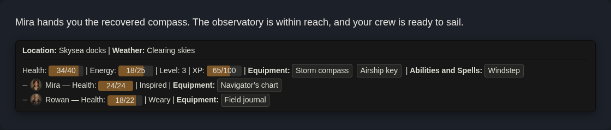
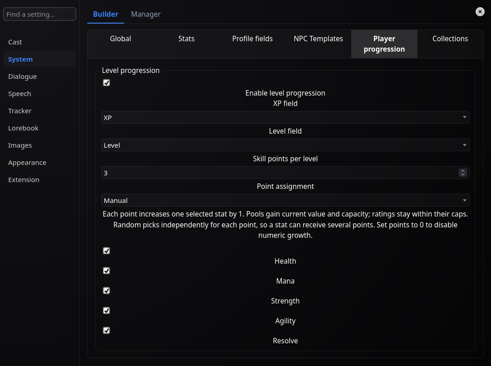
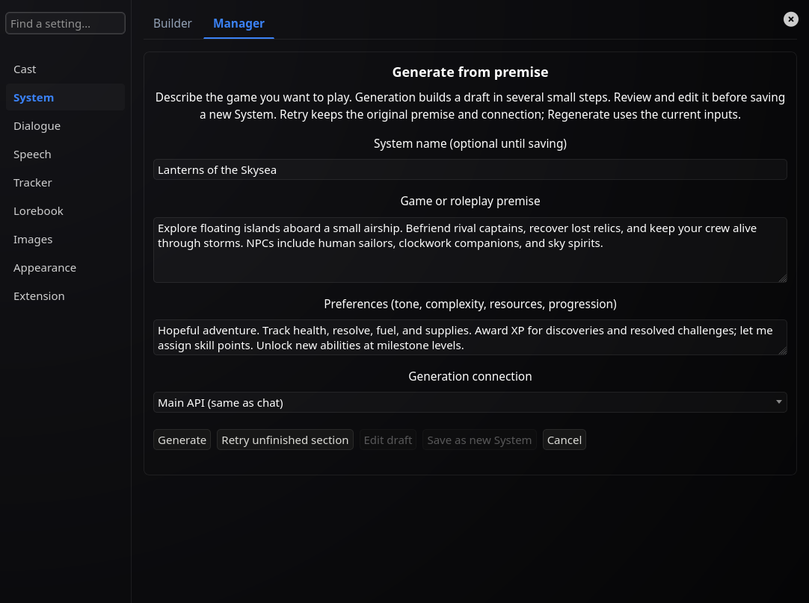
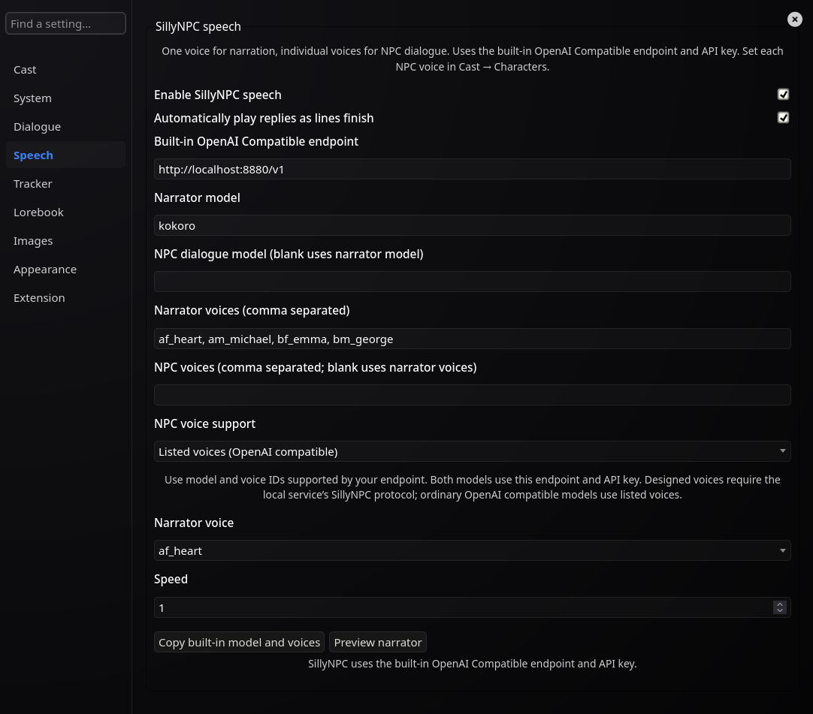

<p align="center">
  
</p>

# SillyNPC XP

Give your roleplay a cast you can see, hear, and watch grow.

NPC portraits, character sheets, and RPG tracking for SillyTavern. A background reader follows the story and updates stats, inventory, and XP. Let changes apply automatically or review them yourself.

This is a fork of [BrutalKoala's SillyNPC](https://github.com/BrutalKoala/SillyNPC), with more room to build your own game.

## What it does

- **Makes dialogue easy to follow.** Each speaker gets a portrait and their own colour. Narration stays between speech blocks, so you can tell who's talking at a glance. Click a portrait to open that character's sheet.
- **Keeps the adventure's state in chat.** A tracker under the latest reply shows world details, player and NPC stats, inventory, and conditions. The reader proposes changes as the story unfolds; you can review them or edit values yourself.
- **Puts your player stats within reach.** A floating HUD keeps your portrait and resource meters on screen. Drag it where you like, choose bars or rings, and click the portrait to open your sheet. Its controls are under **Appearance → Floating HUD**.

[](img/chatexmp.png)

| In-chat tracker | Player HUD |
| :---: | :---: |
| [](img/screenshots/in-chat-tracker.png) | [](img/floathudbar.png) |

Dialogue and HUD examples are from upstream; the tracker shows the current fork with example data. Click any image for a closer look.

## What's changed from upstream?

The original dialogue styling, portraits, tracker, and floating HUD are still here. This fork adds:

- **XP and level-ups.** Players and opted-in NPC templates can level up, earn skill points, and unlock collection rewards such as abilities or perks.
- **A cast for each chat.** NPCs belong to the adventure where you meet them. Reuse world characters without sharing their current state.
- **Your own rules.** Build stats, profile fields, and collections for the player and NPC templates such as sailors, robots, and spirits.
- **Complete starter Systems.** Begin with Fantasy Adventure, Dating Sim, or Creature Trainer. Each gives the reader a cast, stats, collections, and a matching HUD; edit any rule to suit your story. You can also generate a System from your own premise.
- **Character memories.** Keep memories on sheets. Reader suggestions always wait for your approval.
- **Individual TTS voices.** Give NPCs their own voices, with a separate narrator. Optional automatic playback starts as dialogue lines finish streaming.
- **Expressions and scene sprites.** Use expression packs or generate missing emotions from NPC portraits. Keep the whole present cast visible beside the chat.
- **A refreshed menu and editable themes.** Shared Player/NPC sheets, searchable settings, and nine presets you can customise.

## Choose a starter System

A fresh install starts with **Fantasy Adventure**. Open **System → Manager** and use **Start from template** to make an editable copy of another starter before your first player message.

| System | What it includes |
| --- | --- |
| **Fantasy Adventure** | One character template for adventurers and beasts; HP, armor, familiar attributes, equipment, and abilities and spells that can be proposed as level-up rewards. |
| **Dating Sim** | One NPC template with affection, trust, comfort, and relationship tracking; Clothing and Items collections; personal memories. |
| **Creature Trainer** | Separate trainer and creature templates; teams, moves, and Items; creature HP and five combat ratings that can grow with levels. |

The stats have prose descriptions so the reader can judge changes from the story. Systems work without a separate rules engine, and you can adjust or replace any starter in the Builder.

## Build your game

| Choose how characters grow | Start with a story idea | Give your cast a voice |
| :---: | :---: | :---: |
| [](img/screenshots/progression.png) | [](img/screenshots/system-premise.png) | [](img/screenshots/speech.png) |

Current UI, with example settings. Click an image for the full view.

## Install

**Use this fork instead of the original SillyNPC.** They share settings and events, so keep only one installed. If you're switching, export a backup first; existing SillyNPC data remains readable.

1. Open SillyTavern's **Extensions → Install Extension**.
2. Paste `https://github.com/i5031337/SillyNPC-levels`.
3. Install and refresh the page.

Or clone it into your installation:

```bash
cd SillyTavern/public/scripts/extensions/third-party
git clone https://github.com/i5031337/SillyNPC-levels.git SillyNPC-XP
```

## Your first adventure

Open **Extensions → SillyNPC → Manage SillyNPC**.

1. **Pick your rules.** Keep the default Fantasy Adventure System, choose another [starter System](#choose-a-starter-system), or use **Generate from premise** in **System → Manager**. Select new rules before your first player message.
2. **Start chatting.** **Dialogue → Ask The Model To Format Dialogue** requests lines like `**Mira**: "All aboard!"` so portraits and colours follow each speaker.
3. **Meet the cast.** Click an unknown speaker's portrait to create a profile and **Fill** missing details, lore, and a portrait. Use **Link as alias** for another name for an existing NPC.
4. **Check the reader.** Under **Tracker**, choose automatic, manual, or inline reading and set **Ask Before Applying**. The tracker starts enabled for new settings; manual mode adds a book button beside Send.
5. **Make it yours.** Edit sheets under **Cast**, choose a theme under **Appearance**, or search for a setting. **Extension → Detailed Settings** reveals extra controls.

## How leveling works

At level 1 with `90/100` XP, earning `+20` takes you to level 2 with `10/100` left over. Larger awards can cross several levels.

Configure points and manual or random allocation under **System → Builder → Player progression**, or per NPC template. Each point adds 1 to an eligible stat. Pools grow their current value and capacity together; ratings respect their caps. The extension handles the maths.

Collections can unlock scheduled or reader-chosen rewards. XP awards are model judgments you can correct on the sheet. One-step undo and rereading/swipe handling help keep changes tied to the latest reply.

## Voices and expressions

**Speech** uses SillyTavern's built-in **OpenAI Compatible** TTS endpoint and API key. Enter supported model and voice IDs, then choose each NPC's **Dialogue voice** in their Edit view. Use Play on a reply or enable automatic playback. Narration and dialogue can use different models. Designed voices need a service supporting the SillyNPC voice-design protocol.

Portraits use SillyTavern's **Image Generation** extension. Toggle automatic portraits under **Images**.

Generated expressions need **Image Edit** installed in `st-image-edit`, ComfyUI, and an API editing workflow with `%reference_image%` and `%prompt%` inputs. Select it under **Images → Expression Editing Workflow**, and choose Local, Extras, or WebLLM in SillyTavern's Expressions settings.

Generate emotions in **NPC Edit → Expressions**, or turn on automatic generation under **Images**. Existing sprites are reused. **Show Present NPC Sprites** keeps the cast visible even with speech off. Extra reader passes and image generation may add provider costs.

## Moving between adventures

Export characters or Systems to reuse them. Characters carry profiles, lore text, and stats marked **NPC carryover**; other adventure state starts fresh. Transfer portrait and sprite files separately. **Extension → Export everything** makes a full extension backup.

## Contributing

Issues and PRs are welcome [on this fork](https://github.com/i5031337/SillyNPC-levels). There's no build step. See the [file map](docs/FILE_MAP.md) for the source layout; run focused tests with `node --test tests/*.mjs`. UI checks also need a running SillyTavern instance.

Built on [SillyNPC by BrutalKoala](https://github.com/BrutalKoala/SillyNPC). [MIT license](LICENSE).
