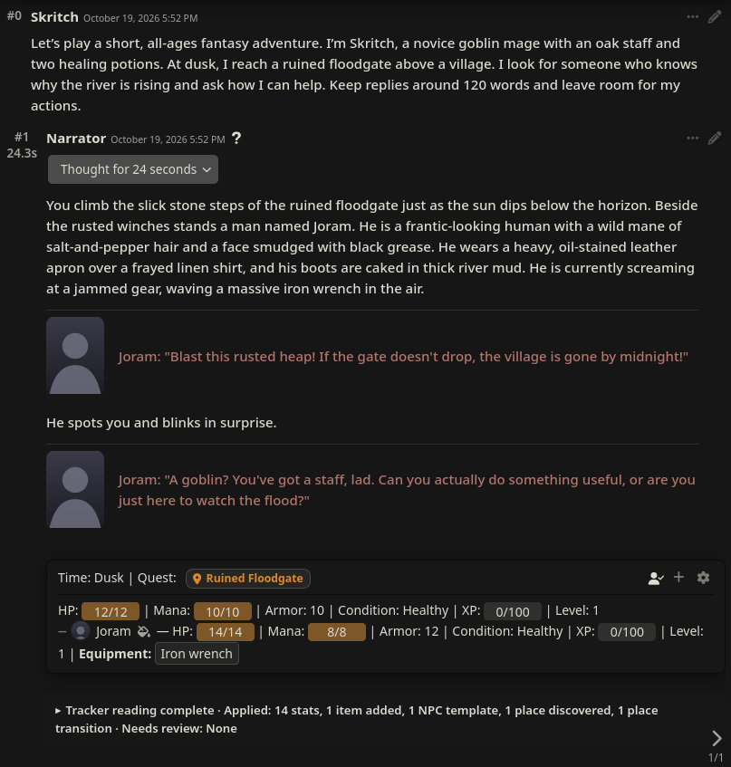
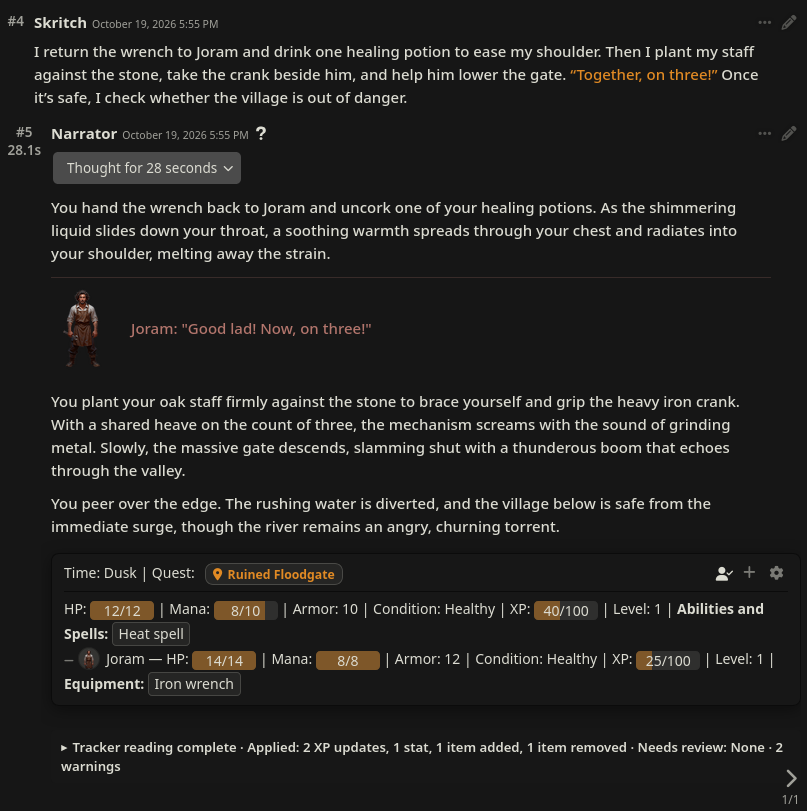

<p align="center">
  
</p>

# Castward

Give your roleplay a cast you can see, hear, and watch grow.

Player and NPC profiles, portraits, voices, and RPG tracking for SillyTavern. Build collections for equipment, abilities, moves, or anything else your game needs.

**Start small: a minimal persona, a narrator character card, and your usual writing preset.** Once your model is connected, the built-in Fantasy Adventure System supplies the tracking rules. Describe who you are and what you want to do, then play.

## Three turns of Fantasy Adventure

Played in a running SillyTavern instance with local **Gemma 4 26B A4B**, the built-in Fantasy Adventure template, and automatic reading. Every turn capture includes the user message and the resulting reply and tracker. No NPC was supplied in advance: the story model introduced Joram, and Castward generated his profile and image from the conversation. Only the player's portrait was already available. No tracked values were manually edited.

**1. Meet someone new, then give them a face.** The reader identifies Joram, tracks his stats and wrench, and remembers the Ruined Floodgate. Click his placeholder portrait to create and Fill his chat-owned card using the configured lore and image services.

| Before: a newly encountered speaker | After: the same exchange following Fill |
| :--- | :--- |
| [](img/screenshots/fantasy-demo/01-new-npc-before-fill.png) | [](img/screenshots/fantasy-demo/02-new-npc-after-fill.png) |

**Joram's generated profile.** Fill turns the conversation into a character sheet with an image, short ancestry and role badges, and readable Appearance and Motivation text sections. Stats and equipment stay on the same sheet.

[](img/screenshots/fantasy-demo/03-generated-profile.png)

The sheet is captured after turn three, with the wrench returned to Joram. Profile generation filled the story-supported details and left Background blank. The demo System's profile display settings were updated to match the corrected starter template; the generated text and tracked values are unchanged.

| 2. Borrow equipment and cast magic | 3. Recover and return the equipment |
| :--- | :--- |
| Joram hands over his wrench. The reader moves it to Skritch's Equipment, records **Heat spell**, spends **2 Mana**, adds **Strained shoulder**, and awards **15 XP**. | Skritch drinks a potion, returns the wrench, and helps close the gate. The reader restores **Healthy**, moves the wrench back to Joram, and brings Skritch to **40/100 XP** and Joram to **25/100 XP**. |
| [](img/screenshots/fantasy-demo/04-magic-and-equipment.png) | [](img/screenshots/fantasy-demo/05-recovery-and-return.png) |

Click any screenshot for the full view. [Transcript, generated profile, reader outputs, and observations from this run](docs/evaluations/fantasy-adventure-live-demo.json), including skipped XP/Level fields and starting gear the reader missed.

This demo uses click-to-Fill. To create profiles as the reader discovers NPCs, enable **Tracker → Generate Profiles For New NPCs**. It is off by default and adds a lore request for each new NPC; **Images → Draw Portrait Automatically** controls the additional image request. Portraits need a configured SillyTavern Image Generation service.

**Change the game rules with the genre.** Choose a System for each new chat: Fantasy Adventure, Dating Sim, Creature Trainer, or one you build. A System brings its player and NPC fields, stats, collections, progression, and display rules together, while you keep the writing preset you like.

**Start chatting with your current writing preset.** A fresh install selects Fantasy Adventure, turns on automatic tracking, and asks the model to label dialogue for speaker portraits. The separate reader follows finished replies and proposes changes to stats, collections, and XP; let them apply automatically or review them yourself.

Castward is maintained by **i5031337**. Built on [SillyNPC by BrutalKoala](https://github.com/BrutalKoala/SillyNPC), it puts player and NPC profiles at the center of your adventure.

**Works out of the box with Gemma 4 E4B.** With a local Gemma 4 E4B GGUF served by llama.cpp and no custom prompt or sampling overrides. See the [tracker evaluation](docs/evaluations/gemma-e4b-tracker-report.md) and [profile evaluation](docs/evaluations/gemma-e4b-profile-report.md) for the tested setup and limits.

## What it does

- **Makes dialogue easy to follow.** Each speaker gets a portrait and their own color. Narration stays between speech blocks, so you can tell who's talking at a glance. Click a portrait to open that character's sheet, or generate one if it doesn't exist yet.
- **Keeps the adventure's state in chat.** A tracker under the latest reply shows world details, player and NPC stats, collections, and conditions. The reader proposes changes as the story unfolds; you can review them or edit values yourself.
- **Makes your own kinds of holdings.** Give player and NPC collections custom fields, share stable item details while tracking values per character, and offer scheduled or reader-chosen rewards at level-up.
- **Leaves room for your writing style.** The default reader makes a separate request after the story reply, so the prose model does not have to write tracker data into its answer. Keep your current writing preset; the optional dialogue-format instruction can be changed or switched off.
- **Puts your player stats within reach.** A floating HUD keeps your portrait and resource meters on screen. Drag it where you like, choose bars or rings, and click the portrait to open your sheet. Its controls are under **Appearance → Floating HUD**.

[](img/screenshots/fantasy-demo/player-hud.png)

The floating HUD after turn two of the demo above, showing the same HP, Mana, and XP as the in-chat tracker.

## Built around your cast

Castward connects the people in your story to the rules and presentation of each adventure:

- **One cast for each adventure.** NPCs have chat-owned identities and state. Reuse a world character in another chat without carrying over everything that happened to them here; export a character when you do want to bring selected details along.
- **A whole ruleset for each adventure.** A System defines player and NPC profile fields, character and world stats, collections, and progression. Start with fantasy, dating, or creature-training rules, build your own, or generate a System from a premise. Choosing one brings the matching reader, sheets, and HUD behavior along with it.
- **Story-derived changes you can check.** The background reader proposes stat, inventory, XP, condition, and place changes from the conversation. Choose automatic application or review, correct the values, and keep level rewards under review.
- **A tested local-model setup.** The tracker and profile generation have been evaluated with Gemma 4 E4B served locally by llama.cpp. The linked evaluations above show the setup and its limits.
- **Characters you can recognize on sight and by voice.** Speaker portraits and colored dialogue lead to their sheets; NPC voices, expressions, and scene sprites give the same cast a presence beyond stat bars.

## What's changed from upstream?

The original dialogue styling, portraits, tracker, and floating HUD are still here. This fork adds:

- **XP and level-ups.** Players and opted-in NPC templates can level up, earn skill points, and unlock collection rewards such as abilities or perks.
- **A cast for each chat.** NPCs belong to the adventure where you meet them. Reuse world characters without sharing their current state.
- **Your own rules.** Build stats, profile fields, and collections for the player and NPC templates such as sailors, robots, and spirits. Collections can have their own fields and target only the kinds of characters who should hold them.
- **Complete starter Systems.** Begin with Fantasy Adventure, Dating Sim, or Creature Trainer. Each gives the reader a cast, stats, collections, and a matching HUD; edit any rule to suit your story. You can also generate a System from your own premise.
- **Character memories.** Keep memories on sheets. Reader automatically suggests memories at a set interval.
- **Persistent places.** Remember locations, aliases, descriptions, and containment in each chat. 
- **Individual TTS voices.** Give NPCs their own voices, with a separate narrator. Optional automatic playback starts as dialogue lines finish streaming.
- **Expressions and scene sprites.** Use expression packs or generate missing emotions from NPC portraits. Keep the whole present cast visible beside the chat.
- **A refreshed menu and editable themes.** Shared Player/NPC sheets, searchable settings, and nine presets you can customise.

## Change genres with Systems

A fresh install starts with **Fantasy Adventure**; you can use it without building a System first. For a new adventure, open **System → Manager** and use **Start from template** to make an editable copy of another starter before your first player message. The chosen System supplies the tracking rules and matching displays for that chat.

| System | What it includes |
| --- | --- |
| **Fantasy Adventure** | One character template for adventurers and beasts; HP, armor, familiar attributes, equipment, and abilities and spells that can be proposed as level-up rewards. |
| **Dating Sim** | One NPC template with affection, trust, comfort, and relationship tracking; Clothing and Items collections; personal memories. |
| **Creature Trainer** | Separate trainer and creature templates; teams, moves, and Items; creature HP and five combat ratings that can grow with levels. As this system is more complicated, I recommend a stronger tracker model. |

The stats have prose descriptions so the reader can judge changes from the story. Systems work without a separate rules engine, as your writing model can infer the significance of stats from the same prose descriptions.

## Collections beyond inventory

A collection is a list of entries owned by the player, NPCs, or selected NPC templates. Choose its fields and whether it counts quantities. Mark stable text, such as an ability's effect, as shared through the Item Library; keep values such as remaining uses personal to each holder. Fantasy Adventure has **Equipment** with quantity and description, plus **Abilities and Spells** with kind, rank, remaining uses, and effect. Creature Trainer gives creatures their own moves with element, category, power, and remaining uses. Make the equivalent for your setting in **System → Builder → Collections**, or include collections when you **Generate from premise**.

The reader proposes entries and changes when the story supports them: an item gained or spent, a spell learned, or an ability whose details change. You can edit holdings on a character's sheet. Collections can also offer predefined rewards at specific levels or ask the reader to choose a story-appropriate new entry when a player or eligible NPC levels up.

## Keep your prose preset

The default **automatic** tracker reads the finished reply in a separate request. Your writing model does not need to include a status block in its prose, and Castward does not require a replacement writing preset. It only sends relevant saved state as context so the story can stay consistent. You can choose a different SillyTavern Connection Manager profile for the reader, run it manually, or switch to inline tracking if you prefer one response for prose and status.

Castward asks the prose model to format speaker dialogue by default so portraits can follow named lines; turn that instruction off under **Dialogue** if your own prompt handles it. Automatic reading makes an additional model request, which can add time or provider cost.

## Build your game

| Choose how characters grow | Start with a story idea | Give your cast a voice |
| :---: | :---: | :---: |
| [](img/screenshots/progression.png) | [](img/screenshots/system-premise.png) | [](img/screenshots/speech.png) |

Current UI, with example settings. Click an image for the full view.

## Install

**Install only one of Castward and the original SillyNPC.** They share settings and events and should not run together.

1. Open SillyTavern's **Extensions → Install Extension**.
2. Paste `https://github.com/i5031337/ST-Castward`.
3. Install and refresh the page.

Or clone it into your installation:

```bash
cd SillyTavern/public/scripts/extensions/third-party
git clone https://github.com/i5031337/ST-Castward.git
```

## Your first adventure

With a model connected, you only need a minimal persona and a narrator character card with your usual writing preset. A name and a short description of who you want to play are enough to begin; you can establish the adventure in your first message. A fresh install already has Fantasy Adventure rules, an automatic reader, and a dialogue-format request for lines like `**Mira**: "All aboard!"` so portraits and colors follow each speaker.

1. **Start chatting.** The reader follows replies and shows story state beneath the latest one. Changes apply automatically unless you choose review.
2. **Meet the cast.** Click an unknown speaker's portrait to create a profile and **Fill** missing details, lore, and a portrait. Use **Link as alias** for another name for an existing NPC.
3. **Change the rules when you want.** Open **Extensions → Castward → Manage Castward** to edit sheets and settings. For a different [starter System](#change-genres-with-systems) or **Generate from premise**, choose it in **System → Manager** before your first player message.
4. **Choose how much to review.** Under **Tracker**, set **Ask Before Applying**, switch to manual or inline reading, or use a separate reader connection. Manual mode adds a book button beside Send.

## How leveling works

At level 1 with `90/100` XP, earning `+20` takes you to level 2 with `10/100` left over. Larger awards can cross several levels.

Configure points and manual or random allocation under **System → Builder → Player progression**, or per NPC template. Each point adds 1 to an eligible stat. Pools grow their current value and capacity together; ratings respect their caps. The extension handles the maths.

Collections can unlock scheduled or reader-chosen rewards. XP awards are model judgments you can correct on the sheet. One-step undo and rereading/swipe handling help keep changes tied to the latest reply.

## Remembering places

**Remember places with this System** is enabled in the built-in Systems. Change it under **Places**; the choice follows the System into every new chat. Add cards yourself, or use the automatic/manual **Tracker** reader to propose discoveries, lasting changes, and movement. In review, you can correct a proposed description before applying it; select any new parent or destination card along with its dependent change.

Cards keep a name, literal aliases, a description, and an optional parent place. The current marker records the **last confirmed place**; newer story prose takes precedence while movement awaits review. Custom System Location fields continue tracking world state independently. Enabled place recall uses the tracker's story-context injection, so keep the Tracker enabled. Inline mode recalls saved places; use automatic or manual reading to discover them.

## Voices and expressions

**Speech** uses SillyTavern's built-in **OpenAI Compatible** TTS endpoint and any API key configured there. Enter supported model and voice IDs, then choose each NPC's **Dialogue voice** in their Edit view. Use Play on a reply or enable automatic playback. Narration and dialogue can use different models.

**Optional local voice design:** Install the [Qwen3-TTS Speech Server](https://github.com/i5031337/qwen3-tts) separately and connect it through SillyTavern's OpenAI Compatible TTS endpoint. Castward can design an NPC's voice from a description on first playback or preview, then reuse it for later dialogue.

Portraits use SillyTavern's **Image Generation** extension. Toggle automatic portraits under **Images**.

**Optional generated expressions:** Install [Image Edit](https://github.com/i5031337/st-image-edit) **for all users**, so it lives in `public/scripts/extensions/third-party/st-image-edit`; Castward imports it from that folder. Configure a ComfyUI URL in SillyTavern's Image Generation settings and save an API-format editing workflow with `%reference_image%` and `%prompt%` inputs. The [Image Edit setup guide](https://github.com/i5031337/st-image-edit#install) explains the required base64 image loader. Select your saved workflow under **Images → Expression Editing Workflow**, and choose Local, Extras, or WebLLM in SillyTavern's Expressions settings. Existing expression packs and scene sprites do not need Image Edit.

Generate emotions in **NPC Edit → Expressions**, or turn on automatic generation under **Images**. Existing sprites are reused. **Show Present NPC Sprites** keeps the cast visible even with speech off. Extra reader passes and image generation may add provider costs.

[](img/screenshots/dialogue-expressions.png)

Staged expression example: Mira starts neutral, then smiles as the beacon comes into view. Each speaker keeps their own color, with narration between their lines.

| Preview and generate an emotion | Keep the present cast beside the chat |
| :---: | :---: |
| [](img/screenshots/expression-editor.png) | [](img/screenshots/scene-sprites.png) |

The editor shows an existing expression pack; the scene view shows both present NPCs with speech off. These are staged examples in the current UI.

## Moving between adventures

Export characters or Systems to reuse them. Characters carry profiles, lore text, and stats marked **NPC carryover**; other adventure state starts fresh. Transfer portrait and sprite files separately. **Extension → Export everything** makes a full extension backup.

## Contributing

Issues and PRs are welcome [on this fork](https://github.com/i5031337/ST-Castward). There's no build step. See the [file map](docs/FILE_MAP.md) for the source layout; run focused tests with `node --test tests/*.mjs`. UI checks also need a running SillyTavern instance.

Castward by **i5031337**. Originally based on [SillyNPC by BrutalKoala](https://github.com/BrutalKoala/SillyNPC). [MIT license](LICENSE).
