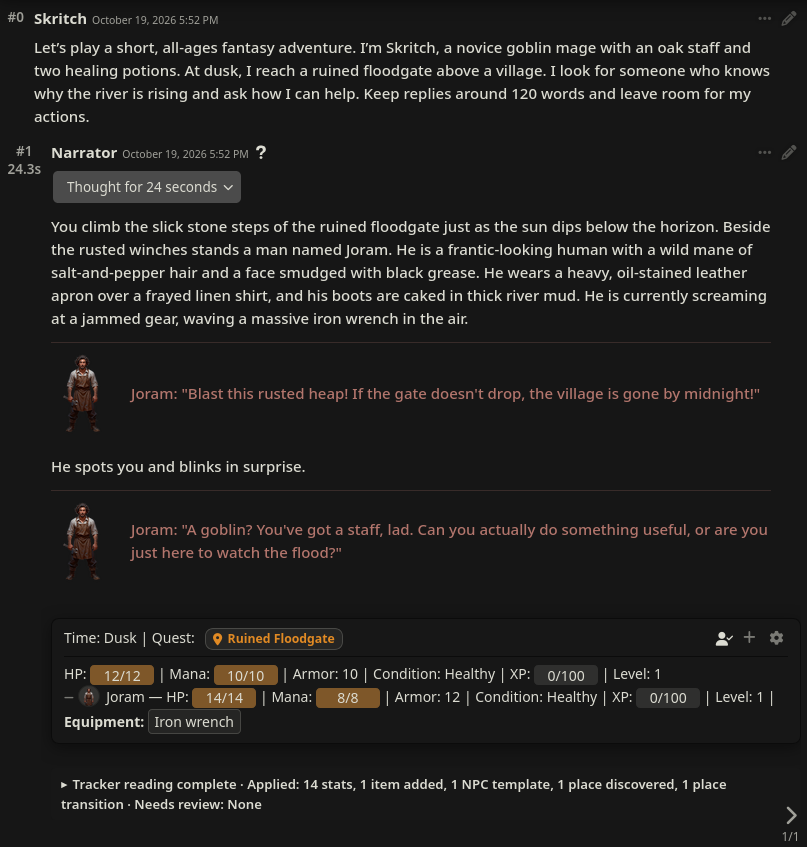
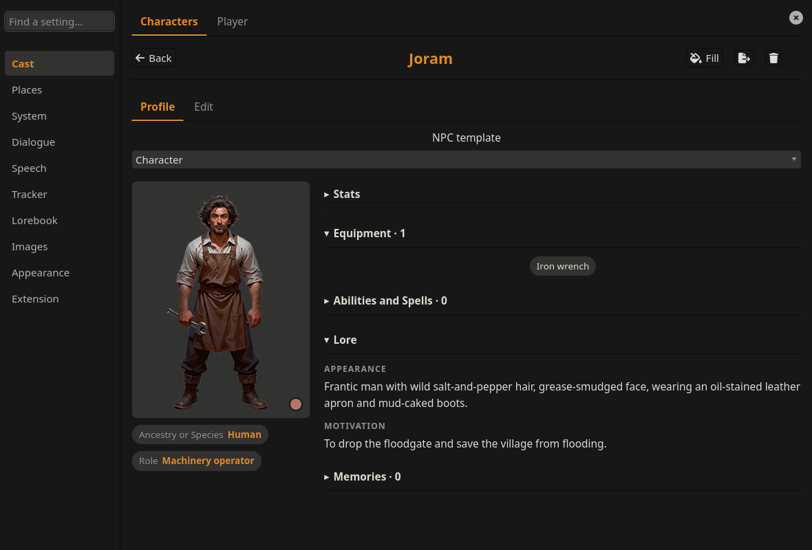
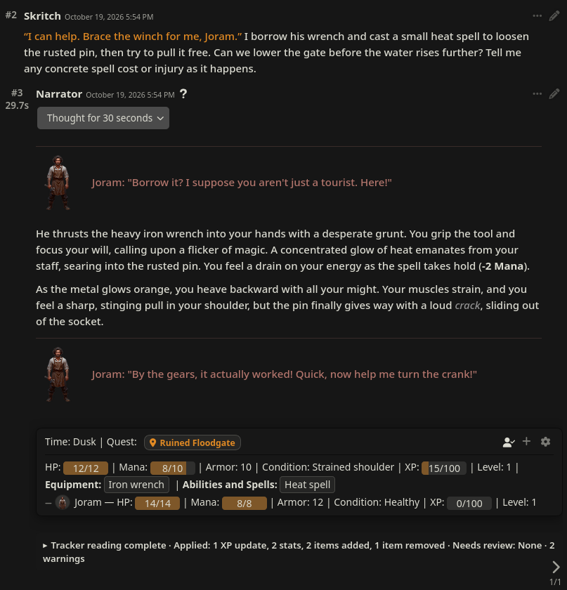
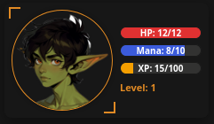
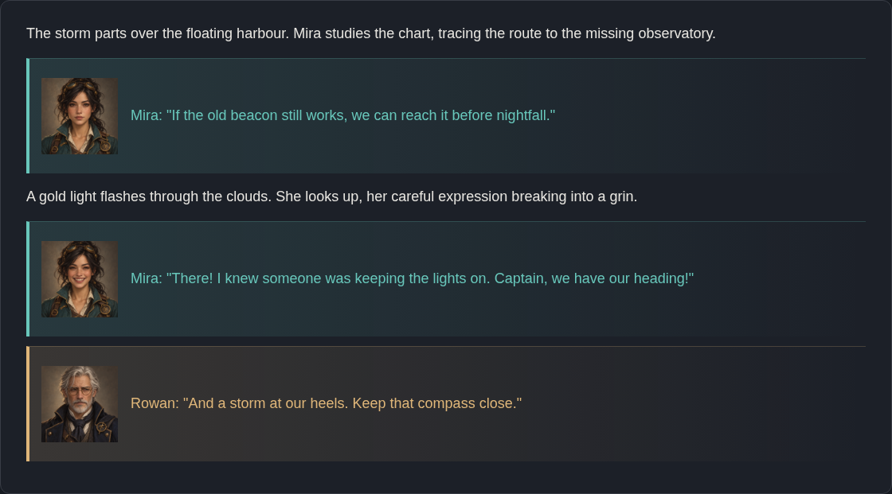
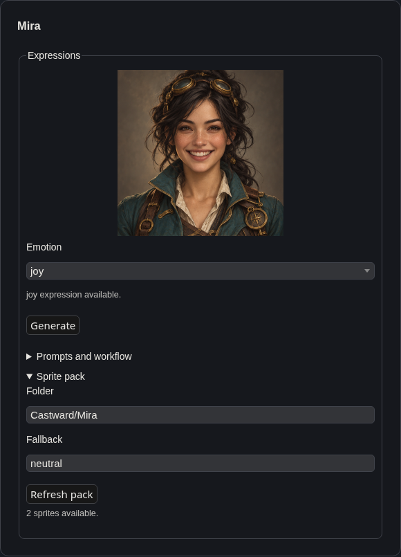
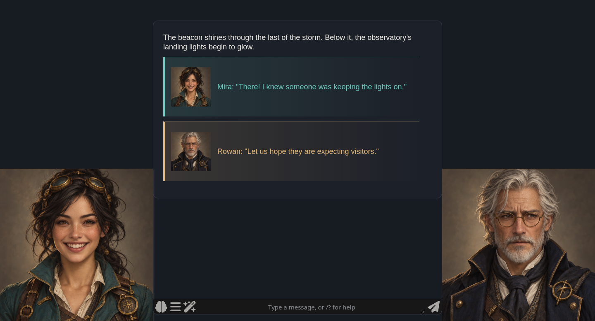

<p align="center">
  
</p>

# Castward

Give your roleplay a cast you can see, hear, and watch grow.

Castward gives your player and NPCs character sheets that grow with the story. A background reader (separate LLM call) follows the conversation and updates their stats and belongings. Keep your usual writing preset and let the adventure unfold.

Start with a minimal persona and a Narrator card. The built-in Fantasy Adventure System supplies the tracking rules, so you can describe who you are and start playing.

Switch between the included Fantasy Adventure, Dating Sim, and Creature Trainer Systems, or customize the rules to fit your own setting.

## Built for local models

I started building this because other trackers struggled with the output from my local model. Castward fixes common formatting slips and keeps the parts of an update it can use.

**Gemma 4 E4B is the minimum reader model I’m aiming to support**, so tracking stays within reach of people with modest hardware. Bigger models can do better with the subtler calls, longer responses, or more complex systems.

I ran ten Fantasy scenes and ten Dating scenes ten times each, with structured output enabled. Here’s how E4B did:

| System | Checks passed | Replies passing every check | Numeric checks passed |
| --- | ---: | ---: | ---: |
| Fantasy Adventure | **1050/1060 (99.1%)** | **91/100** | **104/110 (94.5%)** |
| Dating Sim | **947/960 (98.6%)** | **87/100** | **211/220 (95.9%)** |

It still misses changes and sometimes duplicates an item. Choose **Every change** under **Ask Before Applying** if you want to check each update.

The separate profile test passed **78/78 checks**. The [Fantasy tracker report](docs/evaluations/hp-definition-comparison-20261026-report.md), [Dating tracker report](docs/evaluations/dating-final-10x-20261026-report.md), and [profile report](docs/evaluations/gemma-e4b-profile-report.md) have the setup and full results.

## Two turns of Fantasy Adventure

This session used local **Gemma 4 31B** with the built-in Fantasy Adventure System. The story introduced Joram without a prepared NPC card. Castward generated his profile and portrait from the conversation. No tracked values were edited by hand.

**1. Meet someone new, then give them a face.** The reader picks up Joram's stats and wrench. Clicking his placeholder portrait and choosing **Fill** gives him a profile and picture.

[](img/screenshots/fantasy-demo/02-new-npc-after-fill.png)

His character sheet brings those details together. Here's Joram's sheet from later in the same session.

[](img/screenshots/fantasy-demo/03-generated-profile.png)

**2. Borrow equipment and cast magic.** Joram lends Skritch his wrench. The reader moves it to Skritch's equipment and records the heat spell. Casting costs **2 Mana**, leaves Skritch with a **strained shoulder**, and earns **15 XP**.

[](img/screenshots/fantasy-demo/04-magic-and-equipment.png)

You can read the [full session and reader outputs](docs/evaluations/fantasy-adventure-live-demo.json), including the details it missed.

Profiles are filled on click by default. Turn on **Profiles → Generate Profiles For New NPCs** to fill them as you meet people. Enable **Profiles → Draw Portrait Automatically** to give them pictures too; portraits need a configured SillyTavern Image Generation service.

The narrator can create NPCs with fresh names, distinct personalities, stats, and suitable starting belongings and abilities before introducing them into the story. Previously mentioned or canon characters can keep their established names.

To use this, enable SillyTavern's **Enable function calling** with a supported Chat Completion model. Find the feature under **Dialogue → Let The Narrator Create NPCs** (on by default). Choose the profile-writing model under **Profiles → Profile Connection**. An optional [tool-enabled Narrator card](examples/narrator-tools.json) includes prompts for this feature.

## What it does

Each speaker gets a portrait and their own color, with narration between their lines. Click a portrait to open their sheet. NPCs belong to the chat where you meet them, so another adventure can have its own version of the same character.

Keep building on a familiar world: NPCs, places, and NPC memories can each carry over automatically to new chats, with separate controls for each in your System's settings. Alternatively, start fresh each time.

Character profiles connect to SillyTavern's lorebooks, helping the narrator remember who people are when they appear in the story.

The tracker beneath the latest reply keeps the current state in view. Let the reader apply changes automatically or review them first. You can also edit values on the character sheets.

A floating HUD keeps your player's stats on screen while you scroll. Drag it where you like and click the portrait to open your sheet. Find its settings under **Appearance → Floating HUD**.

[](img/screenshots/fantasy-demo/player-hud.png)

## Change genres with Systems

A System defines what Castward tracks for your adventure. Start with one of the included templates, build your own, or use **Generate from premise** to describe the game you want.

| System | What you can play |
| --- | --- |
| **Fantasy Adventure** | Adventurers and beasts with familiar RPG stats, equipment, and spells. |
| **Dating Sim** | Relationships that develop through affection, trust, and comfort. |
| **Creature Trainer** | Trainers and creatures with teams, moves, and their own progression. A stronger reader model helps with this more involved System. |

Fantasy Adventure is selected on a fresh install. To try another starter, open **System → Manager** and choose **Start from template** before your first player message. You'll get an editable copy to make your own.

Stats have written descriptions that help the reader judge what changed in the story. You can edit those descriptions along with the rules.

## Collections beyond inventory

Collections hold things your characters own or know. Fantasy Adventure uses them for equipment and spells. Creature Trainer uses them for moves.

Make your own under **System → Builder → Collections**. Choose who can use the collection and what each entry needs to record. A spell might have an effect and a number of uses left. The effect can stay the same for everyone while each character tracks their own uses.

The reader updates collections as characters gain, use, or give things away. You can also edit them on the character sheet or offer new entries as level-up rewards.

## Keep your prose preset

The reader makes a separate request after each story reply. Your writing model can concentrate on the story while the reader handles tracking. You can give the reader its own connection through SillyTavern's Connection Manager.

Castward asks for named dialogue lines so it can add speaker portraits. You can change or disable that instruction under **Dialogue**.

Use SillyTavern’s **Stop** button to cancel Castward’s LLM calls, including tracker readings, lore writing, NPC creation, and System generation.

Automatic reading adds a model request each turn. Manual mode lets you choose when to read, and inline mode asks for story and tracking in one reply.

## Install

**Use either Castward or the original SillyNPC.** They share settings and should not run together.

1. Open SillyTavern's **Extensions → Install Extension**.
2. Paste `https://github.com/i5031337/ST-Castward`.
3. Install and refresh the page.

You can also clone it into your installation.

```bash
cd SillyTavern/public/scripts/extensions/third-party
git clone https://github.com/i5031337/ST-Castward.git
```

## Your first adventure

Connect your model, pick a persona and a Narrator card, then start chatting. You can use the included [Narrator card](examples/narrator.json) with my prompts for solo roleplay; no tool calling is needed. A name and a short description of who you want to play are enough to begin. Fantasy Adventure and automatic tracking are already enabled.

To use the included Narrator, save the JSON file and import it through SillyTavern's character menu. Enable **Prefer Char. Prompt** and **Prefer Char. Instructions** to use its prompts. It has no opening message, so start by describing your character and what they want to do.

Open **Extensions → Castward → Manage Castward** to find your cast and settings. Click an unfamiliar speaker's portrait to create their profile, then use **Fill** to add details from the story. If it's another name for someone you already know, choose **Link as alias**.

To check changes before they take effect, enable **Tracker → Ask Before Applying**. You can also switch to manual reading, which adds a book button beside Send.

## How leveling works

At level 1 with `90/100` XP, earning `+20` takes you to level 2 with `10/100` left over. Larger awards can cross several levels. The reader reports the resulting XP total; Castward calculates levels and the remainder, and refuses reader updates that would reduce earned XP.

Choose how many stat points a level earns under **System → Builder → Player progression**. You can assign them yourself or let Castward distribute them randomly. NPC templates can have their own progression too.

Collections can offer set rewards at particular levels or let the reader suggest something that fits the story. You can correct XP awards on the sheet and undo the latest tracker update.

## Optional voices and expressions

Give each NPC their own voice and expressions that change with their dialogue. Castward can create a voice when a character first speaks and generate missing expressions from their portrait. These extras need their own services.

### Voices

Connect a speech service through SillyTavern's built-in **OpenAI Compatible** TTS settings. In Castward's **Speech** menu, choose your model and narrator voice. Each NPC's voice is set in their Edit view. Play replies yourself or turn on automatic playback to hear dialogue as it streams.

For voices designed from a description, install the [Qwen3-TTS Speech Server](https://github.com/i5031337/qwen3-tts). Castward can create an NPC's voice on first playback and reuse it afterward.

### Expressions

Use existing expression packs or generate new ones from NPC portraits with [Image Edit](https://github.com/i5031337/st-image-edit). Install Image Edit **for all users** and follow its [setup guide](https://github.com/i5031337/st-image-edit#install) to configure an editing workflow. Choose that workflow under **Images → Expression Editing Workflow**, and select a classifier in SillyTavern's Expressions settings.

Generate expressions in **NPC Edit → Expressions** or enable automatic generation under **Images**. Castward reuses expressions you've already made.

[](img/screenshots/dialogue-expressions.png)

In this staged example, Mira smiles as the beacon comes into view.

| Make expressions | Keep the cast in view |
| :---: | :---: |
| [](img/screenshots/expression-editor.png) | [](img/screenshots/scene-sprites.png) |

These examples show the expression editor and **Show Present NPC Sprites**, which keeps the cast beside the chat even when speech is off.

## Memories and places

Characters can keep memories on their sheets, and the reader can suggest new ones. **Places** keeps location cards for your adventure and follows discoveries and movement. Link a background image to a place and Castward shows it when that place becomes current. Choose an existing chat image, use the background currently visible, or click **Generate background** on the Place card. To draw images as new places are discovered, enable **Images → Draw New Place Backgrounds Automatically**. Both drawing options use SillyTavern Image Generation and may incur a separate cost. These features have had less testing than profiles and tracking.

## Moving between adventures

Export characters or Systems to reuse them. A character file includes their profile, lore, memories, belongings, conditions, portrait gallery, picture tags, expressions, and voice preferences. Only stats marked **NPC carryover** travel; other stats start from the destination System's defaults. Voice bindings may need checking on the new installation.

Use **Extension → Export everything** for a full extension backup.

## Contributing

[Issues and PRs](https://github.com/i5031337/ST-Castward) are welcome. There's no build step. The [file map](docs/FILE_MAP.md) explains the source layout. Run tests with `node --test tests/*.mjs`. UI checks need a running SillyTavern instance.

Castward by **i5031337**. Originally based on [SillyNPC by BrutalKoala](https://github.com/BrutalKoala/SillyNPC). [MIT license](LICENSE).
